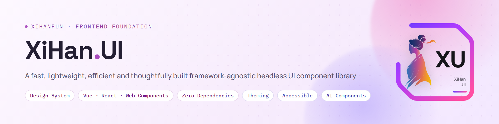

<div align="center">



<h3>One headless core, adapted to Vue, React and Web Components</h3>

<p>
  <a href="https://github.com/XiHanFun/XiHan.UI/actions/workflows/ci.yml"></a>
  <a href="https://www.npmjs.com/package/@xihan-ui/vue"></a>
  <a href="./LICENSE"></a>
  <a href="https://github.com/XiHanFun/XiHan.UI/stargazers"></a>
  <a href="https://gitee.com/XiHanFun/XiHan.UI"></a>
  <a href="https://gitcode.com/XiHanFun/XiHan.UI"></a>
</p>

<p>
  <a href="https://ui.docs.xihanfun.com/en"><b>Docs</b></a> ·
  <a href="#getting-started"><b>Getting Started</b></a> ·
  <a href="https://ui.docs.xihanfun.com/overview"><b>Components</b></a> ·
  <a href="https://ui.docs.xihanfun.com/design/theme-designer"><b>Theme Designer</b></a> ·
  <a href="https://ui.docs.xihanfun.com/changelog"><b>Changelog</b></a>
</p>

<p><b>English</b> | <a href="./README_cn.md">简体中文</a></p>

</div>

XiHan.UI is a framework-agnostic headless UI component library. State, interaction and accessibility logic live in a headless core, with only a thin adapter per framework. It is the frontend foundation of the XiHanFun open-source ecosystem.

## Features

| Feature | Description |
| --- | --- |
| [Framework-agnostic](https://ui.docs.xihanfun.com/guide/connect) | Vue, React and Web Components share one component contract and conformance suite |
| [Comprehensive](https://ui.docs.xihanfun.com/overview) | General, layout, navigation, data entry and display, charts, feedback, overlays and AI chat |
| No third-party dependencies | Nothing beyond the host framework at runtime |
| [Build-time styling](https://ui.docs.xihanfun.com/guide/styling) | DTCG tokens produce CSS variables, skins are layered with `@layer`, no CSS-in-JS |
| [Theming](https://ui.docs.xihanfun.com/en/guide/theme) | Independent switches for mode, brand, density, contrast and writing direction |
| [Accessibility](https://ui.docs.xihanfun.com/en/guide/a11y) | Keyboard interaction follows the W3C APG, scanned in real Chromium |
| [Localization](https://ui.docs.xihanfun.com/guide/i18n) | Ten built-in language packs |
| [AI integration](https://ui.docs.xihanfun.com/guide/ai) | `@xihan-ui/cli` serves component APIs, docs and tokens as an offline knowledge base over MCP |

## Getting Started

```bash
pnpm add @xihan-ui/vue @xihan-ui/tokens @xihan-ui/styles
```

```vue
<script setup lang="ts">
import '@xihan-ui/tokens/tokens.css'
import '@xihan-ui/styles'
import { XhDialogCloseTrigger, XhDialogContent, XhDialogRoot, XhDialogTitle, XhDialogTrigger } from '@xihan-ui/vue'
</script>

<template>
  <XhDialogRoot>
    <XhDialogTrigger>Open dialog</XhDialogTrigger>
    <XhDialogContent>
      <XhDialogTitle>Confirm</XhDialogTitle>
      <XhDialogCloseTrigger>Close</XhDialogCloseTrigger>
    </XhDialogContent>
  </XhDialogRoot>
</template>
```

| Adapter | Package | Usage |
| --- | --- | --- |
| [Vue](https://ui.docs.xihanfun.com/adapters/vue) | `@xihan-ui/vue` | `<XhDialogRoot>` |
| [React](https://ui.docs.xihanfun.com/adapters/react) | `@xihan-ui/react` | `<XhDialogRoot>` |
| [Web Components](https://ui.docs.xihanfun.com/adapters/web-components) | `@xihan-ui/web-components` | `<xh-dialog>` |

The theme runtime and the other adapters are covered in the [quickstart](https://ui.docs.xihanfun.com/en/quickstart). The styling baseline is Chrome 111, Firefox 113 and Safari 16.2.

## Packages

| Layer | Packages (`@xihan-ui/`) |
| --- | --- |
| Adapters | `vue`, `react`, `web-components` |
| Core | `core`, `headless`, `motion`, `pointer`, `position`, `viz` |
| Appearance | `tokens`, `styles`, `icons` |
| Features | `code-highlight`, `markdown`, `chat-stream`, `animations`, `backgrounds`, `sound`, `expression`, `xlsx` |
| Designers | `designer-kit`, `designer-shell` |
| Tooling | `cli` |

Package details, layout and development commands are in the [engineering notes](./ui/README.md).

## Quality

- **Consistency**: the three adapters run a shared suite against one `connect()` and compare normalized DOM.
- **Accessibility**: keyboard interaction follows the W3C APG, with `axe-core` scans in real Chromium.
- **Gates**: lint, type checks, dependency boundaries, structural checks, tests, builds and size, with the same commands locally and in CI.

## Ecosystem

| Project | Description |
| --- | --- |
| [XiHan.Framework](https://github.com/XiHanFun/XiHan.Framework) | A fast, lightweight, efficient, thoughtful .NET framework: microkernel, capability graph, pipeline execution |
| [XiHan.BasicApp](https://github.com/XiHanFun/XiHan.BasicApp) | A beautifully crafted general-purpose admin kernel built on XiHan.Framework and XiHan.UI |

## Documentation

| Destination | Contents |
| --- | --- |
| [Documentation site](https://ui.docs.xihanfun.com/en) | Component pages with the connect API, keyboard tables and state charts |
| [Design guidelines](https://ui.docs.xihanfun.com/design/) | Color, shape, motion and typography |
| [Token browser](https://ui.docs.xihanfun.com/design/token-browser) | Design token lookup |
| [Changelog](https://ui.docs.xihanfun.com/changelog) | Release notes and upgrade advisories |

Ask an AI: [Zread](https://zread.ai/XiHanFun/XiHan.UI) · [DeepWiki](https://deepwiki.com/XiHanFun/XiHan.UI)

## Contributing

[Issues](https://github.com/XiHanFun/XiHan.UI/issues) and pull requests are welcome; see the [contributing guide](./CONTRIBUTING.md). Community: QQ group [462371834](https://qm.qq.com/q/qYp1Urv3z2). Support the project: [sponsorship page](https://docs.xihanfun.com/cosmos/sponsor).

## Acknowledgements

| Project | Influence |
| --- | --- |
| [Zag.js](https://github.com/chakra-ui/zag) | Specification reference for component state charts and ARIA wiring |
| [W3C APG](https://www.w3.org/WAI/ARIA/apg/) | Normative basis for accessible interaction patterns |
| [CommonMark](https://spec.commonmark.org/) | Source of Markdown semantics and conformance criteria |
| [axe-core](https://github.com/dequelabs/axe-core) | Engine for automated accessibility scans |

## License

[MIT](./LICENSE) © 2021-Present XiHanFun and contributors. The XiHan.UI logo, name, interface design and original visual expression belong to the author.
