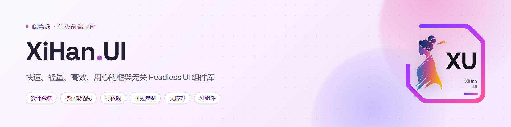

<div align="center">



<h3>一份无头内核，同时适配 Vue、React 与 Web Components</h3>

<p>
  <a href="https://github.com/XiHanFun/XiHan.UI/actions/workflows/ci.yml"></a>
  <a href="https://www.npmjs.com/package/@xihan-ui/vue"></a>
  <a href="./LICENSE"></a>
  <a href="https://github.com/XiHanFun/XiHan.UI/stargazers"></a>
  <a href="https://gitee.com/XiHanFun/XiHan.UI"></a>
  <a href="https://gitcode.com/XiHanFun/XiHan.UI"></a>
</p>

<p>
  <a href="https://ui.docs.xihanfun.com"><b>文档</b></a> ·
  <a href="#快速开始"><b>快速开始</b></a> ·
  <a href="https://ui.docs.xihanfun.com/overview"><b>组件</b></a> ·
  <a href="https://ui.docs.xihanfun.com/design/theme-designer"><b>主题设计器</b></a> ·
  <a href="https://ui.docs.xihanfun.com/changelog"><b>更新日志</b></a>
</p>

<p><a href="./README.md">English</a> | <b>简体中文</b></p>

</div>

XiHan.UI 是框架无关的 Headless UI 组件库，状态、交互与无障碍逻辑集中于无头内核，各框架仅保留薄适配层，属曦寒懿（XiHanFun）开源生态的前端基座。

## 特性

| 特性 | 说明 |
| --- | --- |
| [框架无关](https://ui.docs.xihanfun.com/guide/connect) | Vue、React 与 Web Components 共享同一份组件合同与一致性套件 |
| [覆盖全面](https://ui.docs.xihanfun.com/overview) | 通用、布局、导航、数据录入与展示、图表、反馈、浮层、AI 对话 |
| 零第三方依赖 | 除宿主框架外，运行时不引入第三方包 |
| [构建期样式](https://ui.docs.xihanfun.com/guide/styling) | DTCG 令牌产出 CSS 变量，皮肤按 `@layer` 分层，无 CSS-in-JS |
| [主题](https://ui.docs.xihanfun.com/guide/theme) | 明暗、品牌、密度、对比度与书写方向独立切换 |
| [无障碍](https://ui.docs.xihanfun.com/guide/a11y) | 键盘交互遵循 W3C APG，扫描运行于真实 Chromium |
| [国际化](https://ui.docs.xihanfun.com/guide/i18n) | 内建十种语言包 |
| [AI 集成](https://ui.docs.xihanfun.com/guide/ai) | `@xihan-ui/cli` 以 MCP 提供组件 API、文档与令牌的离线知识库 |

## 快速开始

```bash
pnpm add @xihan-ui/vue @xihan-ui/tokens @xihan-ui/styles
```

```vue
<script setup lang="ts">
import '@xihan-ui/tokens/tokens.css'
import '@xihan-ui/styles'
import { XhDialogCloseTrigger, XhDialogContent, XhDialogRoot, XhDialogTitle, XhDialogTrigger } from '@xihan-ui/vue'
</script>

<template>
  <XhDialogRoot>
    <XhDialogTrigger>打开对话框</XhDialogTrigger>
    <XhDialogContent>
      <XhDialogTitle>确认操作</XhDialogTitle>
      <XhDialogCloseTrigger>关闭</XhDialogCloseTrigger>
    </XhDialogContent>
  </XhDialogRoot>
</template>
```

| 适配器 | 包 | 写法 |
| --- | --- | --- |
| [Vue](https://ui.docs.xihanfun.com/adapters/vue) | `@xihan-ui/vue` | `<XhDialogRoot>` |
| [React](https://ui.docs.xihanfun.com/adapters/react) | `@xihan-ui/react` | `<XhDialogRoot>` |
| [Web Components](https://ui.docs.xihanfun.com/adapters/web-components) | `@xihan-ui/web-components` | `<xh-dialog>` |

主题运行时与其余适配器的写法见[快速上手](https://ui.docs.xihanfun.com/quickstart)。样式底线为 Chrome 111、Firefox 113 与 Safari 16.2。

## 包结构

| 层 | 包（`@xihan-ui/`） |
| --- | --- |
| 适配器 | `vue`、`react`、`web-components` |
| 内核 | `core`、`headless`、`motion`、`pointer`、`position`、`viz` |
| 外观 | `tokens`、`styles`、`icons` |
| 功能 | `code-highlight`、`markdown`、`chat-stream`、`animations`、`backgrounds`、`sound`、`expression`、`xlsx` |
| 设计器 | `designer-kit`、`designer-shell` |
| 工具 | `cli` |

各包说明、目录结构与开发命令见[工程说明](./ui/README_cn.md)。

## 质量保障

- **一致性**：三个适配器对同一份 `connect()` 运行共享套件，比对归一化后的 DOM。
- **无障碍**：键盘交互依 W3C APG 落地，`axe-core` 扫描运行于真实 Chromium。
- **门禁**：lint、类型检查、依赖边界、结构检查、测试、构建与体积，本地与 CI 同一套命令。

## 生态

| 项目 | 说明 |
| --- | --- |
| [XiHan.Framework](https://github.com/XiHanFun/XiHan.Framework) | 快速、轻量、高效、用心的 .NET 开发框架：微内核、能力图谱、管道执行 |
| [XiHan.BasicApp](https://github.com/XiHanFun/XiHan.BasicApp) | 基于 XiHan.Framework 和 XiHan.UI 的超高颜值通用中后台内核 |

## 文档

| 去处 | 内容 |
| --- | --- |
| [文档站](https://ui.docs.xihanfun.com) | 组件页含 connect API、键盘表与状态图 |
| [设计规范](https://ui.docs.xihanfun.com/design/) | 颜色、形状、动效与排版 |
| [令牌浏览器](https://ui.docs.xihanfun.com/design/token-browser) | 设计令牌查询 |
| [更新日志](https://ui.docs.xihanfun.com/changelog) | 版本变更与升级须知 |

AI 问答：[Zread](https://zread.ai/XiHanFun/XiHan.UI) · [DeepWiki](https://deepwiki.com/XiHanFun/XiHan.UI)

## 参与

欢迎提交 [Issue](https://github.com/XiHanFun/XiHan.UI/issues) 与 Pull Request，规范见[贡献指南](./CONTRIBUTING_cn.md)。交流：QQ 群 [462371834](https://qm.qq.com/q/qYp1Urv3z2)。支持项目：[赞助页](https://docs.xihanfun.com/cosmos/sponsor)。

## 致谢

| 项目 | 借鉴 |
| --- | --- |
| [Zag.js](https://github.com/chakra-ui/zag) | 组件状态图与 ARIA 接线的规格参考 |
| [W3C APG](https://www.w3.org/WAI/ARIA/apg/) | 无障碍交互模式的规范依据 |
| [CommonMark](https://spec.commonmark.org/) | Markdown 语义与一致率判据的规范来源 |
| [axe-core](https://github.com/dequelabs/axe-core) | 无障碍自动化扫描引擎 |

## 许可证

[MIT](./LICENSE) © 2021-Present XiHanFun and contributors。XiHan.UI 的 Logo、名称、界面视觉设计与原创视觉表达归作者所有。
