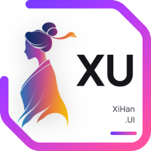

[English](README.md)

# XiHan.UI

框架无关的组件库：状态机与无障碍逻辑沉在无头内核，各框架只写一层薄适配器。

每个组件都有 headless 内核、Vue 与 React 组件、自定义元素和默认皮肤。

> 公开包锁步发版，全部发布在 npm，文档站在 https://ui.docs.xihanfun.com。无障碍扫描跑在真实 Chromium 上，存量违规登记表只剩六条，另有一条 breadcrumb 的步骤重放豁免。

## 包一览

公开包分内核、组件与适配器、表现、内容与效果、开发工具五组，各包的职责、依赖与分层见文档站的[包与依赖关系](https://ui.docs.xihanfun.com/npm-package-dependency)。

`tooling/*` 放构建、lint、tsconfig、测试与脚本等内部包，不对外发布。

## 目录结构

```
ui/
├── packages/     # 对外发布的库包
└── tooling/      # 内部构建与质量工具
```

## 本地开发

要求 Node ≥ 24、pnpm ≥ 11。

```bash
pnpm install --frozen-lockfile
pnpm test         # 单元测试与跨适配器一致性测试（jsdom）
pnpm test:browser # 真实 Chromium 里的无障碍扫描与浮层定位契约（需先 pnpm exec playwright install chromium）
pnpm typecheck
pnpm lint
pnpm boundaries   # 分层依赖门禁（dependency-cruiser）
pnpm build
pnpm size         # 体积棘轮：先构建，再核对 .size-limit.json 里的产物限额
```

## 约定

- 内部运行时依赖一律 `workspace:^`（开发期依赖用 `workspace:*`）；第三方版本只从 workspace catalog 取。
- `packages/engine/motion` 运行时零依赖；`kernel` 只依赖 `motion`，`machine` 只依赖 `kernel`。
- 分层顺序由 dependency-cruiser 强制，不靠自觉。
- 提交遵循 conventional commits；发布走 changesets，所有库包同属一个 fixed 版本组。
